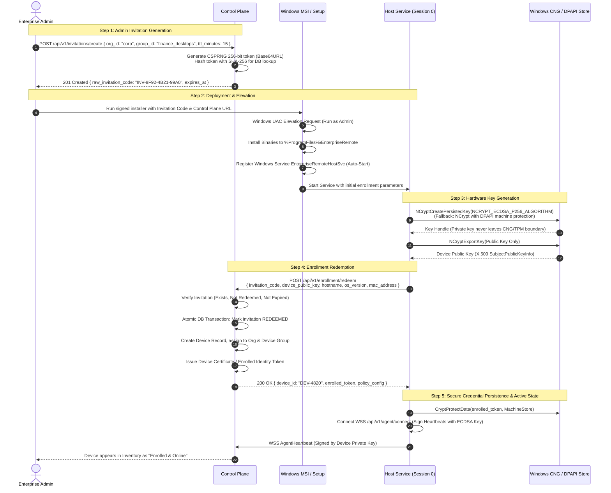

# Enterprise Windows Remote Access Platform: System Architecture & Data-Flow

## 1. High-Level Architecture Overview

The Enterprise Windows Remote Access Platform is engineered with strict privilege separation, zero-trust cryptographic verification, and end-to-end encrypted real-time transport. The platform is segmented into five autonomous, loosely-coupled components:

1. **Windows Host Agent (Target Endpoint)**:
   - **Host Background Service (`EnterpriseRemoteHostSvc`)**: Runs as a Windows Service (Session 0). Manages hardware-backed device cryptographic identity, enrollment lifecycle, control-plane signaling, authorization token verification, and lifecycle enforcement.
   - **Interactive User Session Agent (`EnterpriseRemoteUserAgent`)**: Runs in the active user console session (Session 1+). Performs DXGI Desktop Duplication screen capture, hardware video encoding, cursor tracking, authenticated input injection, and presents a local session indicator/consent UI.
   - **Privilege Separation IPC**: An authenticated Windows Named Pipe with restrictive Security Descriptors (SDDL) connects Session 0 to Session 1+, ensuring Session 0 never touches the interactive desktop directly.

2. **Windows Controller Application (Operator Endpoint)**:
   - Modern desktop application built on .NET 8 (WPF / WinUI 3) providing operator OIDC login, device discovery, multi-monitor selection, WebRTC media rendering, adaptive input dispatch, connection quality metrics, and clipboard/file transfer controls.

3. **Enterprise Control Plane**:
   - Centralized management and signaling service built on ASP.NET Core 8 Kestrel. Enforces RBAC, validates operator OIDC tokens, manages high-entropy single-use device enrollment invitations, maintains cryptographic device inventory, and issues short-lived, digitally-signed Session Authorization Tickets (SAT).
   - Backed by PostgreSQL for relational state and audit events, with Redis for presence and rate-limiting.

4. **Real-Time Transport (WebRTC & TURN Relay)**:
   - Direct peer-to-peer transport via ICE (Interactive Connectivity Establishment) with fallback to enterprise TURN relays. End-to-end media and data encryption via DTLS 1.2/1.3 and SRTP. Relays operate in zero-knowledge mode without access to session decryption keys.

5. **Management & Audit Interface**:
   - Centralized administrative console for device groups, unattended policy configuration, real-time emergency kill-switches, and SIEM-compliant audit export (CEF / RFC 5424 / JSON).

```mermaid
graph TB
    subgraph Operator ["Operator Workstation (Session 1+)"]
        CtrlUI["Windows Controller App<br/>(WinUI 3 / .NET 8)"]
        CtrlWebRTC["WebRTC Media & Data Engine"]
        CtrlUI <--> CtrlWebRTC
    end

    subgraph ControlPlane ["Enterprise Control Plane"]
        API["REST & JSON-RPC API Gateway"]
        AuthModule["OIDC / OAuth 2.0 Validator"]
        PolicyEngine["Policy & RBAC Engine"]
        SignalSvc["WebSocket Signaling Server"]
        DB[(PostgreSQL Store)]
        RedisCache[(Redis Presence & Rate-Limit)]
        
        API <--> AuthModule
        API <--> PolicyEngine
        API <--> DB
        SignalSvc <--> RedisCache
        PolicyEngine <--> DB
    end

    subgraph Relays ["Enterprise Relays (Zero-Knowledge)"]
        TURN["TURN / STUN Relays (RFC 8656)"]
    end

    subgraph TargetHost ["Target Windows Host Endpoint"]
        subgraph Session0 ["Session 0 (Windows Background Service)"]
            HostSvc["EnterpriseRemoteHostSvc<br/>(LocalSystem / NetworkService)"]
            DeviceCrypto["CNG / DPAPI Key Storage<br/>(ECDSA P-256)"]
            PipeServer["Named Pipe Server<br/>(ACL: Restrictive SDDL)"]
            HostSignal["WSS Signaling Client"]
            
            HostSvc <--> DeviceCrypto
            HostSvc <--> HostSignal
            HostSvc <--> PipeServer
        end

        subgraph Session1 ["Session 1+ (Active User Console Session)"]
            UserAgent["EnterpriseRemoteUserAgent<br/>(Standard User Token)"]
            PipeClient["Named Pipe Client"]
            DXGI["DXGI Desktop Duplication<br/>(Direct3D 11 / NV12)"]
            MFEnc["Media Foundation Encoder<br/>(H.264 / AV1 HW Accel)"]
            InputEngine["Input Injection Engine<br/>(SendInput Bounds Checked)"]
            TrayUI["Session Tray & Status Bar<br/>(Emergency Disconnect)"]
            HostWebRTC["WebRTC Host PeerConnection"]

            PipeClient <--> UserAgent
            UserAgent <--> DXGI
            DXGI --> MFEnc
            MFEnc --> HostWebRTC
            HostWebRTC --> InputEngine
            UserAgent <--> TrayUI
            UserAgent <--> HostWebRTC
        end
        
        PipeServer <=== "Authenticated IPC (Named Pipe)" ===> PipeClient
    end

    %% Signaling & Auth connections
    CtrlUI -- "1. OIDC Sign-In & Device Query" --> API
    CtrlWebRTC <== "2. WSS Signaling (SAT Token)" ==> SignalSvc
    HostSignal <== "WSS Heartbeat & Signaling" ==> SignalSvc

    %% Media Transport
    CtrlWebRTC <=== "Direct DTLS-SRTP P2P" ===> HostWebRTC
    CtrlWebRTC -. "TURN Relay Fallback (Encrypted)" .-> TURN
    TURN -. "Encrypted Relayed Packets" .-> HostWebRTC
```

---

## 2. Sequence Flow: Workflow A (Connect to Windows Computer)

This sequence illustrates the end-to-end lifecycle when an operator initiates a remote access session.

```mermaid
sequenceDiagram
    autonumber
    actor Operator as Operator (Alice)
    participant Ctrl as Windows Controller
    participant CP as Control Plane
    participant HostSvc as Host Service (Session 0)
    participant UserAgent as User Session Agent (Session 1+)
    actor LocalUser as Local Target User (Bob)

    Note over Operator, CP: Step 1: Authentication & Discovery
    Operator->>Ctrl: Launch app & authenticate (OIDC / SSO)
    Ctrl->>CP: POST /api/v1/auth/token (OIDC Bearer)
    CP-->>Ctrl: Returns Operator Identity & Claims (RBAC: Tier-2 Operator)
    Ctrl->>CP: GET /api/v1/devices (Authorized Filter)
    CP-->>Ctrl: [Device-101 (Online), Device-102 (Offline)]

    Note over Operator, HostSvc: Step 2: Session Authorization & Negotiation
    Operator->>Ctrl: Select Device-101 & Request Session
    Ctrl->>CP: POST /api/v1/sessions/request { device_id: "101", mode: "interactive" }
    CP->>CP: Evaluate Policy (RBAC, Device Group, Time Window, Attended Rule)
    alt Unattended Access Allowed by Policy
        CP->>CP: Grant immediate approval
    else Local Approval Required
        CP->>HostSvc: WSS SessionRequestEvent { session_id, operator_name }
        HostSvc->>UserAgent: IPC Notification: RequestLocalConsent
        UserAgent->>LocalUser: Display Consent Dialog ("Alice requests remote access")
        LocalUser->>UserAgent: Click "Approve Session"
        UserAgent->>HostSvc: IPC ConsentResult(Approved)
        HostSvc->>CP: WSS SessionConsentResponse(Approved)
    end

    Note over CP, HostSvc: Step 3: Cryptographic Ticket Issuance
    CP->>CP: Generate Session Authorization Ticket (SAT)<br/>Signed with CP Private Key (TTL: 60s)
    CP-->>Ctrl: 200 OK { sat_token, turn_credentials, host_public_key }
    CP->>HostSvc: WSS DispatchSession { sat_token, session_id }

    Note over Ctrl, HostSvc: Step 4: WebRTC Signaling via Control Plane
    Ctrl->>CP: WSS SendOffer { session_id, sdp_offer }
    CP->>HostSvc: WSS ForwardOffer { session_id, sdp_offer }
    HostSvc->>UserAgent: IPC ForwardOfferToPeer { sdp_offer }
    UserAgent->>UserAgent: Verify SAT signature & device binding
    UserAgent->>UserAgent: Initialize DXGI Capture & WebRTC PeerConnection
    UserAgent->>HostSvc: IPC SendAnswer { sdp_answer }
    HostSvc->>CP: WSS SendAnswer { session_id, sdp_answer }
    CP->>Ctrl: WSS ForwardAnswer { session_id, sdp_answer }

    Note over Ctrl, UserAgent: Step 5: Direct Encrypted Transport & Control
    Ctrl<<=>>UserAgent: ICE Candidate Exchange & DTLS Handshake
    Note over Ctrl, UserAgent: Secure DTLS-SRTP Audio/Video & SCTP Data Channels Established
    UserAgent->>TrayUI: Show Active Session Notification ("Alice is connected")
    UserAgent->>Ctrl: Stream Desktop Video (DXGI -> Media Foundation H.264)
    Ctrl->>UserAgent: Send Authenticated Input Events (SCTP Data Channel)
    UserAgent->>UserAgent: Sanitize & Bounds-Check -> SendInput()

    Note over Operator, LocalUser: Step 6: Session Termination
    Operator->>Ctrl: Click "Disconnect" (or LocalUser clicks "Emergency Stop")
    Ctrl->>UserAgent: Send SCTP ControlMessage::Disconnect
    UserAgent->>UserAgent: Stop Capture, Flush Encoder, Close PeerConnection
    UserAgent->>HostSvc: IPC SessionClosed { reason: "OperatorDisconnected" }
    HostSvc->>CP: WSS SessionTerminatedEvent { duration, bytes_sent, exit_code }
    CP->>CP: Write Immutable Audit Log to PostgreSQL
```

---

## 3. Sequence Flow: Workflow B (Device Enrollment & Identity Lifecycle)

This sequence details the zero-trust enrollment protocol using high-entropy, expiring invitations and hardware-backed cryptographic keys.



---

## 4. Privilege Boundary & Session Isolation

A fundamental security failure of legacy remote tools is running the screen capture and input injection entirely within Session 0 as LocalSystem. Windows Vista and later isolate services in Session 0, which has no access to the interactive desktop. Attempting to bypass this via desktop duplication hacks or running GUI processes directly in Session 0 degrades security and fails on modern Windows versions.

Our platform enforces strict separation:

| Component | Windows Session | Privilege Context | Capabilities & Permissions |
| :--- | :--- | :--- | :--- |
| **Host Service** (`EnterpriseRemoteHostSvc`) | Session 0 | `LocalSystem` (or `NT AUTHORITY\NetworkService`) | - Cryptographic key storage (machine store)<br/>- Network communication to Control Plane (outbound 443)<br/>- Process creation into interactive sessions (`CreateProcessAsUser`)<br/>- Named Pipe Server (`\\.\pipe\EnterpriseRemote_IPC_<SessionId>`) |
| **User Session Agent** (`EnterpriseRemoteUserAgent`) | Session 1+ | Interactive Console User (`Standard User`) | - Direct3D 11 & DXGI Desktop Duplication<br/>- Media Foundation hardware video encoder<br/>- Local tray status window & notification banner<br/>- Input injection (`SendInput`) restricted to active desktop<br/>- Connects as client to Named Pipe |
| **Controller UI** (`EnterpriseRemoteController`) | Operator Session | Standard User | - OIDC token storage (DPAPI user store)<br/>- Direct3D video rendering<br/>- Local keyboard/mouse event capture |

### Named Pipe Security Descriptor (SDDL)
The Named Pipe created by the Host Service uses an explicit security descriptor that restricts connection rights strictly to:
- `SY` (LocalSystem): Generic All
- `BA` (Built-in Administrators): Generic All
- `S-1-5-5-X-Y` (Logon SID of the active console session user): Read, Write, Synchronize
- **Deny Everyone Else**: Prevents unauthorized local users from tampering with the remote session IPC stream.
