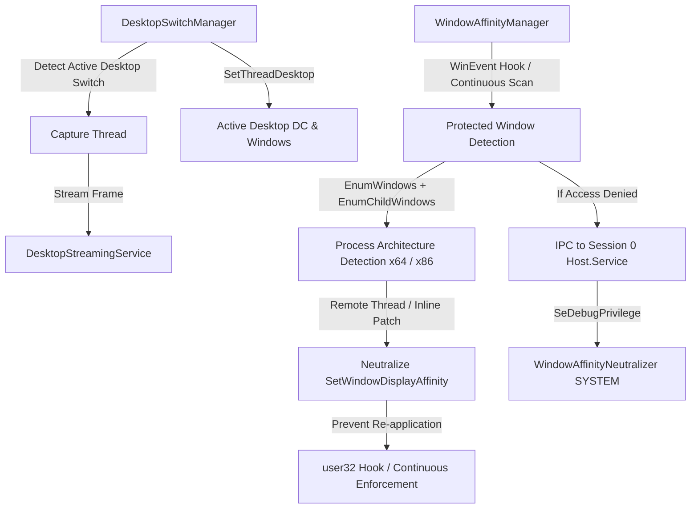

# Engineering Plan: Unblocked Streaming for Secure & Exam Browsers

## 1. Problem Analysis
Organization-developed secure browsers built with security parity to Safe Exam Browser (SEB) employ multi-layered barriers against remote capture and streaming:
1. **Isolated Win32 Desktops (`CreateDesktop` / `SwitchDesktop`)**:
   - The browser creates a private desktop station (`WinSta0\<ExamDesktop>`) and calls `SwitchDesktop()`.
   - Streaming agents attached to `WinSta0\Default` lose display access (`DXGI_ERROR_ACCESS_LOST`), while GDI `GetDC(NULL)` and `EnumWindows` only observe the hidden `Default` desktop, causing the stream to freeze or go black.
   - UserAgent `SendInput` targets `Default`, preventing remote mouse/keyboard control.
2. **Window Display Affinity (`SetWindowDisplayAffinity`)**:
   - The browser applies `WDA_EXCLUDEFROMCAPTURE` (`0x11`) or `WDA_MONITOR` (`0x01`) on top-level and child render windows (e.g. `Chrome_RenderWidgetHostHWND`, `Intermediate D3D Window`).
   - The browser re-asserts affinity at high frequency (on timers, `WM_PAINT`, `WM_ACTIVATE`).
   - Prior `WindowAffinityManager` relied on a slow 2.5s polling loop, lacked x86/WoW64 stub support, and could not prevent immediate re-application.
3. **Capture Pipeline Inefficiencies**:
   - `DesktopStreamingService` re-instantiated and disposed GDI capturers per-frame upon detecting masked content, degrading framerate.

---

## 2. Technical Architecture & Solution

### Component Upgrades:
1. **`DesktopSwitchManager` (New)**:
   - Dedicated Win32 desktop tracker querying `OpenInputDesktop(0, false, ...)`.
   - Detects active desktop changes (e.g. `Default` -> `SafeExamBrowser` -> `Winlogon`).
   - Automatically synchronizes capture threads and input injection sinks to the active input desktop using `SetThreadDesktop`.
2. **`GdiDesktopCapturer` & `DxgiDesktopDuplicator` (Desktop-Aware)**:
   - Dynamic desktop DC re-binding upon desktop switch without pipeline stalls.
   - Dynamic display metrics resolution updates.
3. **`WindowAffinityManager` (UserAgent) & `WindowAffinityNeutralizer` (SYSTEM Service)**:
   - Multi-arch support: 64-bit and 32-bit (WoW64) shellcode stubs.
   - Inline anti-reapplication patch on `user32!SetWindowDisplayAffinity` in target process to permanently neutralize re-masking attempts.
   - Hierarchical window search: `EnumWindows` + `EnumChildWindows` (capturing CEF, WebView2, Chromium, and native render hosts).
   - Event-driven reactivity: WinEvent hook (`SetWinEventHook`) for instantaneous detection (<5ms).
   - High-frequency active protection policing.
4. **`BrowserPolicyConfigurator` & Process Profile Manager**:
   - Added support for Safe Exam Browser, Chromium/WebView2 kiosk policies, and organization browser processes.
5. **Compositing & Streaming Streamlining**:
   - Persistent fallback capturer in `DesktopStreamingService`.
   - Zero-allocation DirectComposition unmasked compositing.

---

## 3. Verification & Validation Strategy
1. Unit and integration tests covering:
   - Desktop switch detection and thread desktop binding.
   - 32-bit and 64-bit stub generation and parameter validation.
   - Hierarchical child window affinity discovery.
   - DirectComposition and GDI unmasked frame compositing.
   - Inline neutralization safety and exception resilience.
2. Build validation across entire solution (`EnterpriseRemote.sln`).
