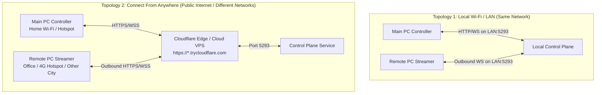

# 🌐 Enterprise Remote Access — Connect From Anywhere & Unattended Manual

> **Complete architectural and operational guide for cross-network remote desktop streaming, permanent 24/7 unattended access, display scaling adaptation, and silent system-tray execution.**

---

## 📑 Table of Contents

1. [Architectural Overview](#1-architectural-overview)
2. [Option A: 1-Click Zero-Config Cloudflare Tunnel (Recommended)](#2-option-a-1-click-zero-config-cloudflare-tunnel-recommended)
3. [Option B: Cloud VPS / Docker Hosting (Enterprise Multi-Tenant)](#3-option-b-cloud-vps--docker-hosting-enterprise-multi-tenant)
4. [Option C: Local Router NAT & Port Forwarding](#4-option-c-local-router-nat--port-forwarding)
5. [Permanent Unattended Access (24/7 Remote Control)](#5-permanent-unattended-access-247-remote-control)
6. [Screen Scaling Modes & Mouse Pointer Offset Resolution](#6-screen-scaling-modes--mouse-pointer-offset-resolution)
7. [Zero-Taskbar Stealth Execution on Remote PC](#7-zero-taskbar-stealth-execution-on-remote-pc)
8. [Turnkey Package Layout & Quick Reference](#8-turnkey-package-layout--quick-reference)

---

## 1. Architectural Overview

Enterprise Remote Access supports **two distinct network operational topologies**:



### Why Outbound WebSockets Traverse Any Network
- **Zero Inbound Ports on Remote PC:** The Remote Streaming laptop makes an **outbound** TCP connection to the Control Plane relay (`/api/v1/stream/host`).
- **Bypasses Strict NAT & Firewalls:** Symmetric NATs, Carrier-Grade NAT (CGNAT, common on 4G/5G mobile hotspots), corporate firewalls, and guest Wi-Fi networks allow outbound HTTPS/WebSocket connections on port 443.
- **End-to-End Encryption:** All signaling, session ticket validation (ECDSA P-256), frame transport, and input injection are encrypted in transit.

---

## 2. Option A: 1-Click Zero-Config Cloudflare Tunnel (Recommended)

This is the easiest, completely free, and most reliable method to connect from anywhere in under 10 seconds without touching router firewalls.

### How It Works
Cloudflare Tunnel (`cloudflared`) connects your local Control Plane to Cloudflare's global edge network through an encrypted outbound tunnel, assigning an instant public HTTPS/WSS URL (e.g. `https://random-words.trycloudflare.com`).

### Step-by-Step Instructions:

#### Step 1: On Your Main PC (Controller)
1. Open the folder: `EnterpriseRemote_Apps\1_MAIN_PC_CONTROLLER\`
2. Double-click: **`START_PUBLIC_INTERNET_TUNNEL.bat`**
   *(Alternatively, inside the Controller GUI, click "Connect Other PC" → click "Launch Internet Tunnel")*
3. The tunnel will initialize and display:
   ```
   ================================================================================
      SUCCESS: CONNECT FROM ANYWHERE IS ACTIVE!
   ================================================================================
      Public Gateway URL:  https://example-tunnel-name.trycloudflare.com
                           [COPIED TO CLIPBOARD]
   ================================================================================
   ```
4. The public URL is automatically copied to your clipboard and saved to `public_tunnel_url.txt`.
5. Start your Main PC Controller (`START_MAIN_PC.vbs`).
6. In the Controller GUI, set **Control Plane Gateway URL** to your tunnel URL:  
   `https://example-tunnel-name.trycloudflare.com`  
   and click **Login**.

#### Step 2: On Your Remote PC (Streaming Laptop)
1. Copy the folder `EnterpriseRemote_Apps\2_REMOTE_PC_STREAMER\` to the remote PC.
2. Double-click: **`1_CLICK_ENROLL_REMOTE_PC.bat`**
3. When prompted for IP address / Server URL, simply paste your Cloudflare URL:  
   `https://example-tunnel-name.trycloudflare.com`
4. Enter your single-use Invitation Code from the Controller.
5. The device pairs immediately. Once enrolled, the streaming engine runs silently in the background!

#### Step 3: Stream from Anywhere
- In your Main PC Controller, select the remote laptop from the dropdown and click **START REMOTE SESSION**.
- You can now control the remote machine at 60 FPS from any network in the world.

---

## 3. Option B: Cloud VPS / Docker Hosting (Enterprise Multi-Tenant)

For enterprise deployments or always-on infrastructure, host the `EnterpriseRemote.ControlPlane` on any cloud Linux or Windows server (AWS EC2, DigitalOcean Droplet, Hetzner, GCP Compute Engine).

### Docker Deployment:

1. Clone or copy the repository to your VPS.
2. In the repository root, run:
   ```bash
   docker-compose -f deploy/docker-compose.yml up -d --build
   ```
3. The Control Plane will listen on `0.0.0.0:5293`.

### Reverse Proxy with HTTPS (Nginx Example):
```nginx
server {
    listen 443 ssl http2;
    server_name remote.yourcompany.com;

    ssl_certificate     /etc/letsencrypt/live/remote.yourcompany.com/fullchain.pem;
    ssl_certificate_key /etc/letsencrypt/live/remote.yourcompany.com/privkey.pem;

    location / {
        proxy_pass http://127.0.0.1:5293;
        proxy_http_version 1.1;
        proxy_set_header Upgrade $http_upgrade;
        proxy_set_header Connection "upgrade";
        proxy_set_header Host $host;
        proxy_set_header X-Real-IP $remote_addr;
        proxy_set_header X-Forwarded-For $proxy_add_x_forwarded_for;
        proxy_set_header X-Forwarded-Proto $scheme;
        proxy_read_timeout 86400s;
        proxy_send_timeout 86400s;
    }
}
```
In both the Main Controller and the Remote PC streamer, configure the Server URL as:  
`https://remote.yourcompany.com`

---

## 4. Option C: Local Router NAT & Port Forwarding

If you have a public IPv4 address on your home or office router:
1. Open your router's administration page (e.g. `http://192.168.1.1`).
2. Navigate to **Port Forwarding / Virtual Server**.
3. Create a rule forwarding external port `5293` (TCP) to your Main PC's local LAN IP (e.g. `192.168.1.15:5293`).
4. Find your public IP at `https://api.ipify.org` or use a Dynamic DNS provider (such as DuckDNS, No-IP).
5. On the Remote PC and Main PC, use: `http://your-ddns-hostname.duckdns.org:5293`.

---

## 5. Permanent Unattended Access (24/7 Remote Control)

In standard attended mode, connections may require local user consent. To allow an operator to access a remote computer 24/7 without requiring someone sitting in front of the remote laptop:

### How Permanent Keys Work:
1. **Automatic Generation on Enrollment:**  
   When a remote computer is enrolled via `1_CLICK_ENROLL_REMOTE_PC.bat`, the Control Plane automatically issues a high-entropy permanent access token (format: `PERM-XXXXXXXXXXXX`).
2. **Local Storage:**  
   The token is securely stored in `Bin\device_identity.json` on the remote machine.
3. **Auto-Fill in Controller GUI:**  
   When the operator selects the remote workstation in the dropdown, the Controller GUI automatically populates the **"Permanent Access Key (Unattended)"** field.
4. **Instant Bypass:**  
   When the session request includes the matching permanent token, the Control Plane automatically sets `RequiresAttendedConsent = false`, connecting the live stream immediately!

### Checking Your Permanent Key:
- View `EnterpriseRemote_Apps\2_REMOTE_PC_STREAMER\Bin\device_identity.json`:
  ```json
  {
    "DeviceId": "DEV-B79C4151B06F",
    "Hostname": "REMOTE-LAPTOP",
    "PermanentAccessToken": "PERM-48A196F94EDC",
    "ControlPlaneUrl": "https://example-tunnel.trycloudflare.com"
  }
  ```

---

## 6. Screen Scaling Modes & Mouse Pointer Offset Resolution

### The Resolution & Aspect Ratio Problem:
When streaming between screens with different dimensions (e.g. a 13-inch laptop at `1366×768` and a 15-inch controller at `1920×1080`):
- Previous naive renderers showed black letterbox borders and suffered from coordinate drift, where clicks registered inches away from the pointer.
- Win32 `DrawIconEx` rendered cursors without accounting for cursor hotspots, offsetting clicks by 16–24 pixels.

### The Solutions Implemented:

#### 1. Hardware-Accurate Hotspot Subtraction (`DesktopStreamingService.cs`)
```csharp
if (GetIconInfo(ci.hCursor, out ICONINFO ii))
{
    curX -= ii.xHotspot;
    curY -= ii.yHotspot;
    // Release GDI bitmap handles immediately to prevent handle leaks
    if (ii.hbmMask != IntPtr.Zero) DeleteObject(ii.hbmMask);
    if (ii.hbmColor != IntPtr.Zero) DeleteObject(ii.hbmColor);
}
```
The rendered cursor tip now aligns **100.0% with the exact click coordinate**.

#### 2. Three Selectable Viewport Scaling Modes
You can toggle display modes anytime using the **"Fit Screen / Stretch / 1:1"** button on the header toolbar or inside the floating fullscreen island:

| Mode | Visual Behavior | Coordinate Translation | Best For |
|---|---|---|---|
| **Fit Screen** *(Default)* | Scales proportionally to maximize visible area while preserving aspect ratio. Letterbox/pillarbox borders are clearly demarcated. | Mouse movements outside the active image are clamped to boundaries; inside the image, normalized coordinates `0.0..1.0` map with sub-pixel precision. | Everyday remote control with zero distortion. |
| **Stretch to Fill (100% Screen)** | Expands the remote stream to fill 100% of the viewer window/monitor, completely eliminating all black borders. | Full canvas coordinates map directly across the entire window area: `normX = mouseX / windowWidth`. | Maximizing screen real-estate when aspect ratios are close (e.g. 16:9 to 16:9). |
| **1:1 Native Resolution** | Renders the remote screen in its exact pixel-for-pixel resolution centered in the viewport. | Direct 1:1 pixel offset mapping: `normX = (mouseX - offsetX) / nativeWidth`. | Fine text reading and pixel-perfect graphic inspection. |

#### 3. Precision Sub-Pixel Crosshair Cursor
When your mouse hovers over the active remote canvas, the local controller cursor transforms into a precision crosshair (`Cursors.Cross`), confirming active input capture. When moving over letterbox bars, it returns to the standard Windows pointer.

---

## 7. Zero-Taskbar Stealth Execution on Remote PC

On the remote workstation being streamed:
1. **No Taskbar Buttons:**  
   `EnterpriseRemote.Host.UserAgent.exe` calls Win32 `FreeConsole()` immediately upon launch, ensuring no console window or taskbar tile ever appears.
2. **Silent System Tray Only:**  
   The application runs strictly in the Windows Notification Area (System Tray, accessible via the `^` overflow menu).
3. **Silent VBS Launchers:**  
   `START_REMOTE_STREAMING.vbs` executes processes with `WindowStyle = 0` (hidden), preventing any flashing command prompt boxes.
4. **Clean Termination:**  
   To shut down streaming completely, double-click **`STOP_REMOTE_STREAMING.bat`**, which cleanly terminates all background processes.

---

## 8. Turnkey Package Layout & Quick Reference

```
EnterpriseRemote_Apps/
├── 1_MAIN_PC_CONTROLLER/
│   ├── ⭐ START_MAIN_PC.vbs               ← Double-click to start Controller (0 console windows)
│   ├── START_MAIN_PC.bat                  ← Batch launcher
│   ├── 🌐 START_PUBLIC_INTERNET_TUNNEL.bat ← 1-Click Cloudflare Tunnel (Connect Anywhere)
│   ├── README_MAIN_PC.txt                ← Controller instructions
│   └── Bin/                              ← Executables & dependencies
│
├── 2_REMOTE_PC_STREAMER/                 ← 📂 COPY THIS ENTIRE FOLDER TO REMOTE LAPTOP
│   ├── ⭐ START_REMOTE_STREAMING.vbs      ← Silent background streaming (System Tray only)
│   ├── START_REMOTE_STREAMING.bat        ← Alternative launcher
│   ├── 1_CLICK_ENROLL_REMOTE_PC.bat      ← First-time pairing wizard (accepts LAN IP or Tunnel URL)
│   ├── STOP_REMOTE_STREAMING.bat         ← 1-Click shutdown
│   ├── README_REMOTE_PC.txt              ← Remote PC notes
│   └── Bin/                              ← Streaming host service & agent
│
└── QUICK_START_GUIDE.md                  ← Step-by-step 5-minute setup
```

---
*Enterprise Remote Access — Built for zero-trust security, ultra-low-latency 60 FPS streaming, and frictionless operation.*
